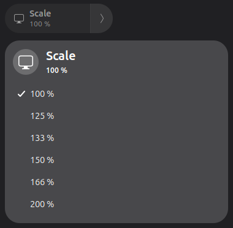

<h1 align="center">Display Scale</h1>

<p align="center">
  Change the display scale from GNOME's Quick Settings menu.
</p>

<p align="center">
  
</p>

Display Scale adds a **Scale** button to Quick Settings. It lists the same scales that
Settings → Displays offers for the current resolution (100 %, 125 %, 133 %, 150 %…), with a check
on the active one. Nothing extra: no custom values, no preferences window.

## Features

- **Same options as Settings.** The scales come straight from GNOME for the current resolution, so
  the list changes when the resolution does, and you can only pick scales GNOME accepts.
- **Several monitors.** Each display gets its own list, titled with its name (for example
  "Built-in display"). Changing one display moves the others so they stay side by side.
- **Always up to date.** The menu refreshes when you plug in a monitor or change the scale or
  resolution in Settings.
- **Safe like Settings.** After you pick a scale, GNOME asks *Keep these display settings?*. Click
  **Keep Changes** to save it; if you don't answer within 20 seconds, the previous scale comes
  back. With several monitors, the question appears on the primary display.
- The button's subtitle shows the scale of the primary display.

## Compatibility

GNOME 46 to 50: Ubuntu 24.04 LTS to 26.04 LTS, and other distributions with those GNOME
versions. Tested on Wayland.

Fractional scales (125 %, 133 %, 150 %…) appear only when GNOME offers them. On Ubuntu 24.04, if you
see only 100 % and 200 %, turn on **Fractional Scaling** in Settings → Displays.

## Installation

### From extensions.gnome.org

Search for **Display Scale** on [extensions.gnome.org](https://extensions.gnome.org/) or in the
Extension Manager app.

### From source

```bash
git clone https://github.com/juanfer-rg/display-scale.git
cd display-scale
make install
```

`make install` links the folder into `~/.local/share/gnome-shell/extensions/`. On Wayland, log
out and back in, then:

```bash
make enable
```

To remove it, run `make disable` and then `make uninstall`.

## Development

| Command       | What it does                                                               |
| ------------- | -------------------------------------------------------------------------- |
| `make pack`   | Builds `dist/display-scale@juanfer-rg.github.io.shell-extension.zip`       |
| `make verify` | Asks GNOME to validate every scale of the first monitor; nothing is applied |
| `make lint`   | ESLint with the GNOME Shell style (run `npm install` once first)           |
| `make logs`   | Follows GNOME Shell's log                                                   |

### How it works

The extension talks to `org.gnome.Mutter.DisplayConfig` over D-Bus, the same interface GNOME
Settings uses:

- `GetCurrentState` gives the monitors, their current mode and the scales each mode supports.
- `ApplyMonitorsConfig` applies the new scale as a persistent change (which is what makes GNOME
  ask for confirmation), keeping the resolution, rotation, primary display
  and the other monitor options (underscanning, color mode, RGB range) as they were.
- The `MonitorsChanged` signal keeps the menu in sync.

That code lives in `displayConfig.js` and only depends on Gio and GLib, so it also runs outside
GNOME Shell with `gjs` (that is what `make verify` does). `extension.js` builds the Quick Settings
button and menu.
